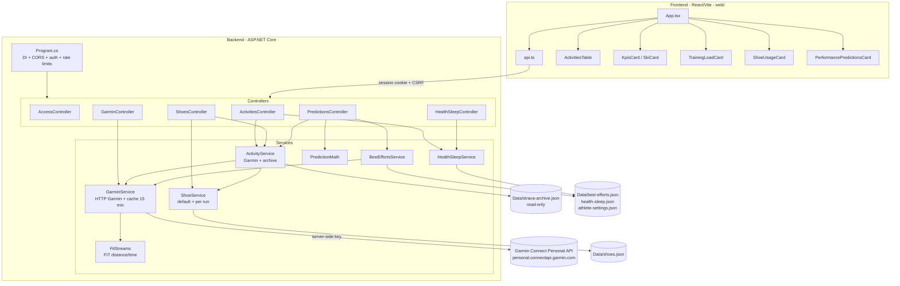

# FabRun Architecture Schema

## Mermaid Diagram

## Files

- Mermaid source: `docs/architecture-schema.mmd`
- Markdown preview: `docs/architecture-schema.md`

## Export to PNG/SVG

- Open `docs/architecture-schema.mmd` in Mermaid Live Editor.
- Export as SVG or PNG.
